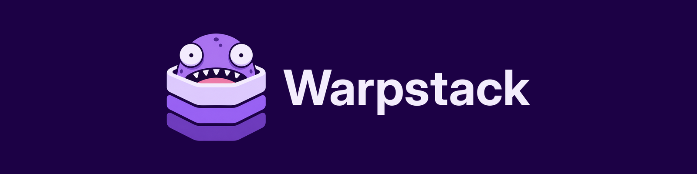

<p align="center">
  
</p>

<p align="center"><b>Building blocks for Farcaster clients.</b></p>

Warpstack is a set of simple, feature-complete building blocks for Farcaster clients. Users
hold their own keys, Snapchain serves as the database, and Cloudflare runs everything. Agents
can build and maintain it safely.

The goal: anyone, a team or an agent, assembles a complete, sovereign client in under an hour.

With Warpstack you can power your own client without depending on Network School, Neynar or any
other third-party infrastructure. You just need a Snapchain node and a dream.

> [!NOTE]
> **Warpstack is early and evolving quickly.** It's built with care: your keys stay on your
> phone, the security-critical code is small and built on widely used, well-documented
> libraries, and dependencies are kept to a minimum ([how](docs/security.md)). Still, it hasn't
> been independently audited, and no software is free of risk, so use it at your own risk
> and expect breaking changes before 1.0. Found a security issue? Please report it privately
> ([`SECURITY.md`](SECURITY.md)).

**What works today:** the phone app reads feeds, channels, profiles, threads and
notifications, and posts, replies, likes, recasts and follows. The server runs on Cloudflare
Workers, or locally with no Cloudflare account.

## How it fits together

| Package | What it does |
| --- | --- |
| [`protocol`](packages/protocol) | Builds, signs and checks Farcaster messages. Sealed core. |
| [`wallet`](packages/wallet) | The phone's vault: your recovery phrase is typed into a native screen, used once and wiped, and never reaches JavaScript. The app's own key lives in the Keychain, wrapped by the Secure Enclave. Sealed core. |
| [`contract`](packages/contract) | The API, defined once as typed routes. |
| [`api`](packages/api) | The Cloudflare Worker: follows Snapchain into a cast index, keeps each user's private state in a Durable Object. Holds no key that can act as you. |
| [`client`](packages/client) | The headless data layer and React hooks. |
| [`app-core`](packages/app-core), [`ui`](packages/ui) | The app's wiring and its default screens. |
| [`apps/app`](apps/app) | The Expo app for iPhone and the web, and the deploy. |
| [`create-warpstack-app`](packages/create-warpstack-app) | Makes a new app of your own: `pnpm create warpstack-app my-app`. |

The **sealed core** (`protocol`, `wallet`, and the server's fetchers) is where a mistake could
cost someone their account. A human approves every change there.

## Start your own

You need Node 22 and pnpm 10.

```sh
pnpm create warpstack-app my-app
```

That's a complete client and its server in a folder of your own, with the building blocks from
npm. It walks you through the rest; so does its `SETUP.md`.

## Run this repository

```sh
pnpm install
pnpm check                                  # typecheck, lint and every test, offline
cp apps/app/.dev.vars.example apps/app/.dev.vars
pnpm dev                                    # the server and web app on localhost, no Cloudflare account
```

**Your own server:** [`apps/app/SETUP.md`](apps/app/SETUP.md) walks through it: about ten
minutes in a browser, then `pnpm run deploy --fid <your FID>`.

**The iPhone app** needs Xcode and Rust (the vault's core is Rust):

```sh
cd apps/app && EXPO_PUBLIC_API_URL=https://<your server> pnpm run ios:release
```

## What's next

Planned:

- **Mini apps:** open Farcaster mini apps inside your client, with sign-in approved on the
  phone.
- **Push notifications, search, and Android.**
- **Linking a browser to your phone,** so the web app can post, not just read.

Being considered:

- **One vault, many clients:** import your phrase once into a vault app, then connect any
  number of Warpstack clients, each with its own revocable posting key.
- **Passkey sign-in:** a passkey-protected copy of the phrase, for signing in on a new phone.
- **An app wallet** for mini apps and onchain actions.
- **Choosing your server in the app,** so one published app can connect to any server.

None of these exist yet, and plans will change.

## Read more

- [`docs/architecture.md`](docs/architecture.md): the principles, a diagram of the packages, and
  how to use them alone or together.
- [`docs/security.md`](docs/security.md): why the keys live on the phone, why the vault is in
  Rust, what your server can and can't do, and the sealed core.

## Contribute

Read [`CONTRIBUTING.md`](CONTRIBUTING.md) and [`AGENTS.md`](AGENTS.md). Report security issues
privately: see [`SECURITY.md`](SECURITY.md).

## Credits

Warpstack's original design is by [horsefacts](https://github.com/horsefacts). Icons come from Octicons, the
Farcaster client, Lucide and Simple Icons; see [`NOTICE`](NOTICE).

## License

[MIT](LICENSE).
