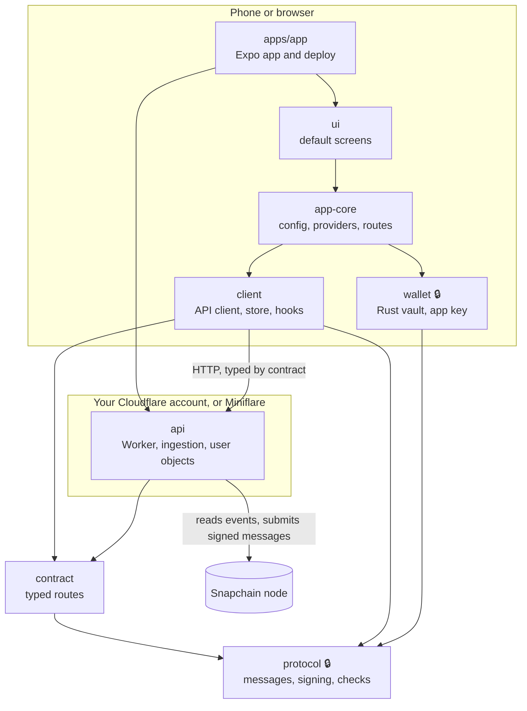

# Architecture

Warpstack is seven packages, one app and a generator. Each package does one job behind a small
public API, and each can be used without the ones above it. This page covers the principles
they follow, how they fit, and how to use them alone or together. It describes the code as it
is today.

## Principles

When principles conflict, the order is **safety, then ownership, then cost, then convenience.**
A safe but expensive feature waits; a cheap but unsafe one never ships. Most principles are
enforced by a check (a test, a lint rule or CI), not by review.

**Purpose**

1. **Simple, feature-complete building blocks for any kind of client.** A social app, a
   single-channel community or an agent's client is assembled from the same blocks.

**Trust and security** (more in [`security.md`](security.md))

2. **Users hold their keys and sign on their own device.** The server never holds a key that
   can act as a user.
3. **Keys are separated by what they risk.** The recovery phrase owns the account and is used
   only to add or remove a key. A separate app key posts, with only the scopes it needs.
4. **The security-critical core is small, hardened and built on trusted open source.** The
   sealed core changes only with a human's approval and is tested against outside reference
   vectors.
5. **Nothing is signed blind.** Native code decodes what it signs and refuses what it can't
   explain.
6. **Untrusted content is handled once, on the server, behind strict limits.** A phone never
   loads a URL someone posted.

**Architecture**

7. **Ports and adapters.** A boundary counts only if two implementations pass the same tests,
   usually a real adapter and an in-memory fake.
8. **One typed contract; everything else is derived from it.** Handlers, the client, query
   keys, cache rules and rate limits follow from one file.
9. **Snapchain is the database.** Everything the server stores is a rebuildable cache, except
   a short list of per-user state.

**Running it**

10. **Minimal dependencies; extras through optional adapters.** The base is a Snapchain node and
    somewhere to run a Worker. A missing adapter turns a feature off with a clear message; it
    never breaks the app.
11. **Cloudflare, and Miniflare locally.** Workers, Durable Objects, D1, R2 and Images, each
    behind a port. Local hosting never needs a Cloudflare account.
12. **The cost budget is a design constraint.** Every route declares a cost class.

**Code and tooling**

13. **A few best-in-class dependencies, one per job.** Hono, Zod 4, oRPC, TanStack Query, Expo,
    noble and scure in TypeScript, alloy in Rust.
14. **Strict, meaningful types everywhere.** Branded domain types, parsing at every boundary,
    errors as values.
15. **Tooling guides agents to quality.** Types, lint rules, fakes and a fast offline
    `pnpm check` steer agents; guardrails only a human can loosen protect what agents must not
    change alone.

## How it fits

🔒 marks the sealed core. Arrows are package dependencies, except the two labelled ones, which
are network calls. Signed messages are made on the phone; the Worker checks them and passes
them to Snapchain, and can't make one itself.

## The packages

| Package | Job | Depends on | Use it alone for |
| --- | --- | --- | --- |
| [`protocol`](../packages/protocol) 🔒 | Branded types (`Fid`, `CastHash`…), Farcaster message builders and hashes, the gasless key typed data, signature checks, session challenges, the recovery-phrase guard | noble, scure | Building or verifying Farcaster messages in any TypeScript runtime |
| [`contract`](../packages/contract) | Every API route as typed facts: path, auth, freshness, cost; Zod schemas for every entity. The OpenAPI snapshot is derived from it | protocol | A typed spec of the API, or generating a client in another language from the OpenAPI file |
| [`api`](../packages/api) | The Cloudflare Worker: ingests Snapchain into a D1 cast index, serves the contract, keeps each user's private state in a Durable Object per FID, fetches untrusted links and images through the sealed fetchers | contract, protocol | A backend for any client, including one not built on Warpstack |
| [`client`](../packages/client) | The headless data layer: `createClient` (typed API, entity store, account, viewer state), and React hooks in `client/react` | contract, protocol | A custom UI in any React or React Native app, or a non-React script through the core |
| [`wallet`](../packages/wallet) 🔒 | The phone's vault: the recovery phrase in Rust, the app key in the Keychain wrapped by the Secure Enclave. iOS only | protocol | Signing on iOS from any Expo app |
| [`app-core`](../packages/app-core) | The composition root: config, providers, typed links. Renders nothing | client, contract, protocol, wallet | Wiring your own screens to the stack |
| [`ui`](../packages/ui) | The default screens and slots in React Native, for phone and web | app-core, client | Starting from complete screens and replacing the ones you want |
| [`apps/app`](../apps/app) | The Expo app, its Worker entry point and `pnpm run deploy` | everything | A complete client to run or fork |
| [`create-warpstack-app`](../packages/create-warpstack-app) | Makes a standalone copy of `apps/app` that installs the packages from npm | nothing at runtime | Starting a new app outside this repo |

`core/` code never imports `adapters/`, `app-core` never imports `ui`, and only the fetchers and
fixed-host adapters may call `fetch`. Lint enforces each of these.

## Using them alone or together

- **The whole client.** Run or fork `apps/app`: the phone app, the web app and your own server.
  Start with the [README](../README.md) and [`apps/app/SETUP.md`](../apps/app/SETUP.md).
- **Your own screens on the stack.** Keep `api`, `client`, `app-core` and `wallet`; replace `ui`.
  Screens get data only through the `client/react` hooks, which return `Read<T>`,
  `ListState<T>` or `Action<I, O>` and report every failure as a `WarpError`.
- **A different front end.** Use `client` with any API deployment. `createClient({ baseUrl })`
  with no keys gives a read-only client, which can read a deployment set to `ACCESS=public`
  (a private one needs a session for every read); signing needs an `AppKeys` implementation, which today
  exists only for iOS (`wallet/native`).
- **Only the backend.** Deploy `api` and call it over HTTP from anything. The contract's
  OpenAPI snapshot (`packages/contract/src/__snapshots__/openapi.json`) describes every route.
- **Only the protocol.** Use `protocol` to build, hash, sign-check or verify Farcaster messages.

- **A new app of your own.** `create-warpstack-app` copies `apps/app` into a standalone project
  whose building blocks come from npm, named for you: the app, its Worker, database and bucket.

Every package is on npm under `@warpstack/`, and the generator is `create-warpstack-app`. To try
a change to them before it's published, `scripts/rehearse-create.sh` generates an app from
packed tarballs.

## Not built yet

Planned, but not in the code: mini apps, an app wallet,
push notifications, Android, linking a browser to the phone (browsers are read-only), and
search. Treat anything not on this page or in the code as not there.
